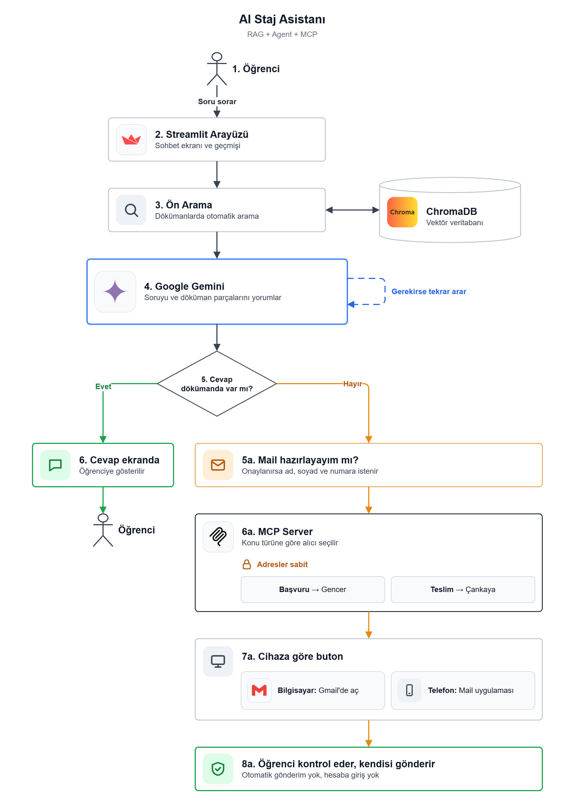

<p align="center">
  
</p>

<h1 align="center">AI Staj Asistanı</h1>

<p align="center">
  SDÜ Bilgisayar Mühendisliği öğrencilerinin staj sorularını resmi bölüm belgelerine dayanarak yanıtlayan,<br/>
  RAG tabanlı ve araç kullanan bir yapay zeka agent'ı.
</p>

<p align="center">
  <a href="https://ai-staj-asistan.streamlit.app/"><strong>Canlı Demo</strong></a>
</p>

<p align="center">
  
  
  
  
  
</p>

---

## Genel Bakış

Staj süreciyle ilgili bilgiler (başvuru adımları, süreler, gerekli belgeler, teslim kuralları) bölümün farklı yıllarda yayımladığı PDF ve Word belgelerine dağılmış durumdadır. Bu proje, öğrencinin bu bilgilere sohbet arayüzü üzerinden, saniyeler içinde ve doğru kaynaktan ulaşmasını sağlar.

Asistan yalnızca bölümün resmi belgelerinden derlenen bilgi bankasına dayanarak cevap verir. Sorunun cevabı belgelerde yoksa bilgi uydurmaz; bunun yerine öğrenciye ilgili staj sorumlusuna hazır bir e-posta taslağı oluşturmayı önerir.

## Mimari

<p align="center">
  
</p>

Dosya ve fonksiyon düzeyindeki ayrıntılar için [detaylı mimari şemasına](gorseller/mimari_sema_detayli.png) bakabilirsiniz.

### Bir sorunun yolculuğu

1. **Arayüz:** Öğrenci sorusunu Streamlit arayüzüne yazar. Sohbet geçmişi oturum boyunca korunur.
2. **Ön arama:** Mesaj, ChromaDB üzerinde anlamsal olarak aranır ve en ilgili belge parçaları bulunur. Bu adım sayesinde soruların çoğu tek bir model çağrısıyla cevaplanır.
3. **Agent:** Gemini; sistem kurallarını, sohbet geçmişini ve bulunan parçaları birlikte değerlendirir. Parçalar yetersizse `dokumanlarda_ara` aracını konuşmanın bağlamına göre daha iyi bir sorguyla yeniden çağırır.
4. **Cevap:** Bilgi belgelerde varsa öğrenciye yalnızca bu bilgilere dayanan bir cevap gösterilir.
5. **E-posta önerisi:** Bilgi belgelerde yoksa asistan e-posta hazırlamayı önerir. Öğrenci onaylarsa ad, soyad ve öğrenci numarası istenir.
6. **MCP aracı:** Gemini, ayrı bir MCP sunucusunda çalışan `komisyona_mail_hazirla` aracını çağırır. Alıcı, konunun türüne göre seçilir.
7. **Gönderim:** Arayüz cihazı algılar ve tek bir buton gösterir. E-postayı öğrenci kontrol eder ve kendisi gönderir.

## Öne Çıkan Özellikler

**Belgeye dayalı cevaplar.** Bilgi bankası, resmi belgelerdeki tekrarlar ve çelişkiler temizlenerek konulara göre altı dosyada toplanmıştır. Her soru-cevap ayrı bir parça olarak indekslenir. Böylece arama sonuçları birbirini tekrar etmez ve bir cevap iki parçaya bölünmez.

**Araç kullanan agent.** Gemini function calling ile çalışan agent, ne zaman arama yapacağına ve ne zaman e-posta aracını kullanacağına kendisi karar verir. Takip sorularında ("Peki donanım stajı için?") aramayı sohbetin bağlamına göre yeniden kurar.

**Güvenli e-posta akışı (MCP).**
- Hiçbir e-posta hesabına giriş yapılmaz ve e-posta otomatik gönderilmez. Araç yalnızca hazır doldurulmuş bir bağlantı üretir.
- Alıcı adresleri kodda sabittir. Agent yalnızca konu türünü seçebilir (`basvuru` veya `teslim`), adres yazamaz.
  - Başvuru ve genel sorular: Arş.Gör. Muhammet Çağrı Gencer
  - Staj teslimi: Dr.Öğr.Üyesi İbrahim Arda Çankaya
- Cihaz otomatik algılanır: bilgisayarda "Gmail'de aç", telefonda "Mail uygulamasında aç" butonu gösterilir.

**Dayanıklılık.** Model geçici olarak yoğun olduğunda (HTTP 503) istek otomatik olarak yeniden denenir. Hatalar sunucu loglarına yazılır, öğrenciye ise anlaşılır bir mesaj gösterilir.

## Teknolojiler

| Katman | Teknoloji |
|---|---|
| Arayüz | Streamlit |
| Dil modeli ve agent | Google Gemini (function calling) |
| Araç protokolü | MCP (Model Context Protocol), stdio üzerinden |
| Vektör veritabanı | ChromaDB |
| Embedding | sentence-transformers, `paraphrase-multilingual-mpnet-base-v2` |
| Belge okuma | pdfplumber, python-docx |
| Barındırma | Streamlit Community Cloud, GitHub Actions ile uyku önleme |

## Proje Yapısı

```
ai-staj-asistan/
├── app.py                 Streamlit arayüzü ve cihaza göre e-posta butonu
├── agent.py               Agent döngüsü: ön arama, Gemini, araç çağrıları
├── mail_mcp_server.py     MCP sunucusu: e-posta bağlantısı üreten araç
├── vector_db.py           ChromaDB bağlantısı ve anlamsal arama
├── text_splitter.py       Bilgi bankasını soru-cevap parçalarına böler
├── document_loader.py     PDF, Word ve metin dosyalarını okur
├── chatbot.py             İlk sürümdeki basit RAG akışı (referans için)
├── dokumanlar/            Bilgi bankası: konulara göre 6 soru-cevap dosyası
├── kaynaklar/             Orijinal resmi belgeler (arşiv, indekslenmez)
├── chroma_db/             Hazır vektör veritabanı
├── gorseller/             Logo ve mimari şemalar
└── .github/workflows/     Uygulamayı uyanık tutan zamanlanmış görev
```

## Kurulum

Gereksinim: Python 3.11 veya üzeri ve bir [Google Gemini API anahtarı](https://aistudio.google.com/apikey).

```bash
git clone https://github.com/Selimcagan32/ai-staj-asistan.git
cd ai-staj-asistan

python -m venv venv
venv\Scripts\activate            # Windows
# source venv/bin/activate       # macOS / Linux

pip install -r requirements.txt
```

Proje kök dizininde bir `.env` dosyası oluşturun:

```
GEMINI_API_KEY=api_anahtariniz
```

Uygulamayı başlatın:

```bash
streamlit run app.py
```

### Bilgi bankasını güncelleme

`dokumanlar/` klasöründeki dosyalar `# Konu` ve `## Soru` başlıklarıyla yazılır. Her `## Soru` başlığı ve altındaki cevap ayrı bir parça olarak indekslenir. Dosyaları düzenledikten sonra `chroma_db/` klasörünü silip uygulamayı yeniden başlatmanız yeterlidir. Veritabanı boş olduğunda uygulama onu otomatik olarak yeniden oluşturur.

## Yol Haritası

- Kullanıcı geri bildirimiyle cevap kalitesinin takibi
- Sık sorulan soruların analizi
- Farklı bölümler için çoklu bilgi bankası desteği

## Geliştirici

**Selim Çağan** · [GitHub](https://github.com/Selimcagan32)
